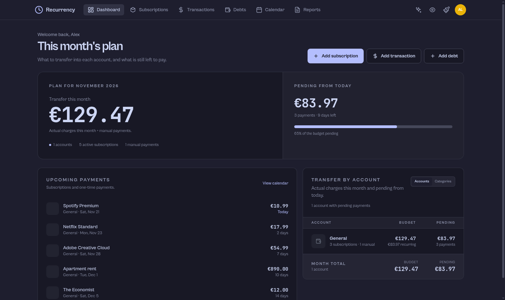
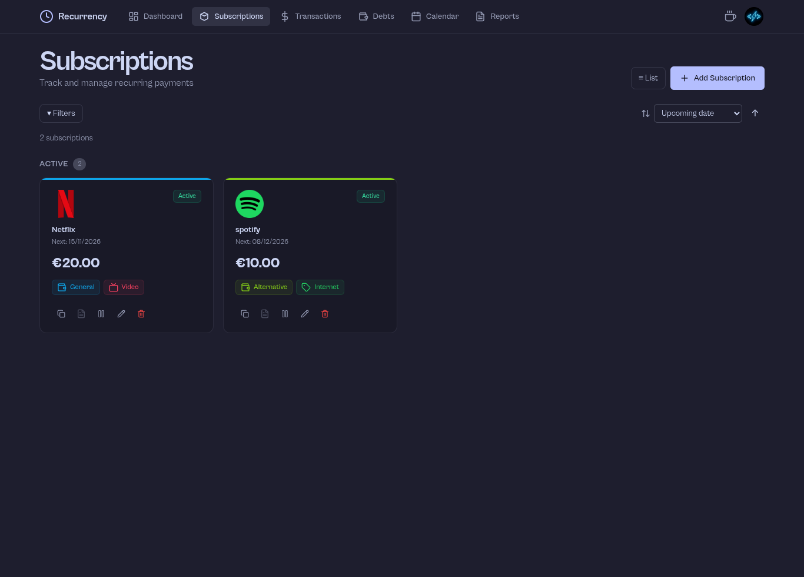
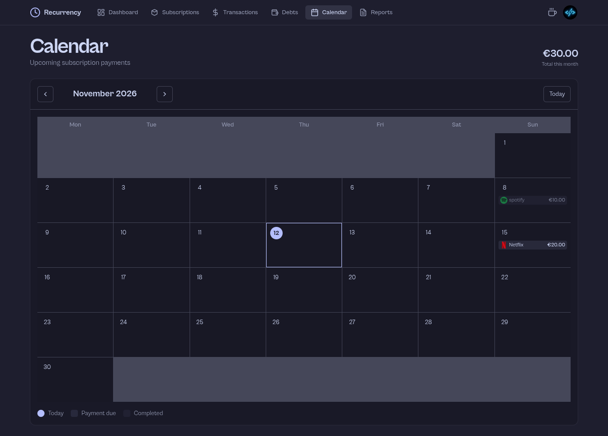
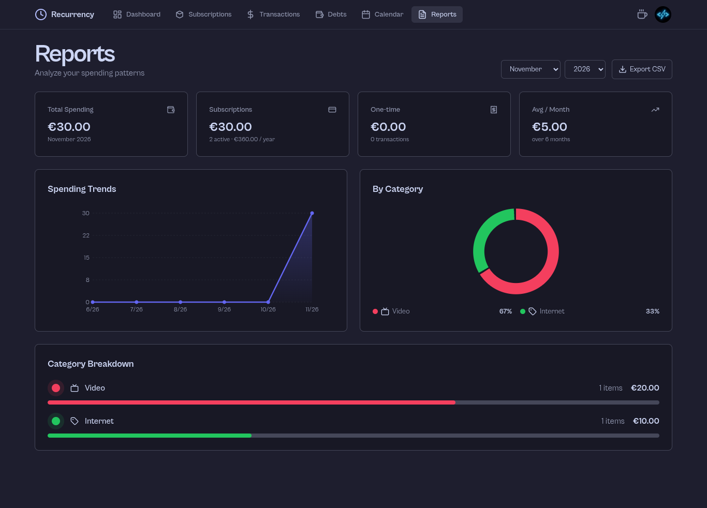

# Recurrency — Current Design System

> **Baseline:** `main` at v0.55.16.
> This document describes the interface that ships today. It is not a redesign
> proposal and it does not describe the Aurora exploration. Any v2 branch starts
> by preserving the behaviour documented here.

Recurrency is a self-hosted subscription, expense and debt tracker. The product
is built around one question: **what do I need to transfer this month, and what
is still pending from today?**

The interface is a monthly ledger, not a generic dashboard. It should feel calm,
factual and fast to scan: money first, explanation second, decoration last.

Reference captures (current UI):

| Dashboard | Subscriptions |
| --- | --- |
|  |  |

| Calendar | Reports |
| --- | --- |
|  |  |

---

## 1. Principles

1. **Ledger before dashboard.** Show real charges and real pending amounts, not
   averages or invented forecasts.
2. **One accent per theme.** The primary colour is for the main action, active
   navigation and progress. Status colours are reserved for status.
3. **Dense, not cramped.** The UI favours compact rows, tabular numbers and
   clear alignment over oversized cards.
4. **State is always visible.** Loading, empty, over-budget, pending and
   up-to-date states have their own treatment.
5. **Privacy is a mode.** Any visible amount can be blurred without hiding the
   rest of the interface.
6. **The same product on every surface.** Web, desktop and Android share the
   same routes, data and controls; only navigation density changes.
7. **No dead controls.** If a button is visible it performs the action it
   promises.

---

## 2. Themes

Themes are persisted in `localStorage` under `recurrency-theme`. There is no
automatic system-theme mode. The default is `mocha`; the toggle cycles
`light → dark → mocha → light`.

| Theme | Character | Background | Card | Primary | Foreground |
| --- | --- | --- | --- | --- | --- |
| `mocha` (default) | soft lavender night | `#1E1E2E` | `#181825` | `#B4BEFE` | `#CDD6F4` |
| `dark` | near-black with amber | `#0C0B0F` | `#131117` | `#E9900C` | `#EDEDED` |
| `light` | warm paper with ink primary | `#F9F8F0` | `#FFFFFF` | `#212121` | `#212121` |

Secondary theme roles:

| Role | Mocha | Dark | Light |
| --- | --- | --- | --- |
| Muted surface | `#454759` | `#24212B` | `#F2F2F2` |
| Muted text | `#949AB3` | `#9591A1` | `#707070` |
| Accent surface | `#313244` | `#3A2403` | `#F3F1E7` |
| Destructive | `#F38CA9` | `#A52727` | `#DC2828` |
| Border | `#454759` | `#211E29` | `#DEDEDE` |

Hex values are approximations of the HSL custom properties in
`frontend/assets/styles/tailwind.src.css`. **The HSL variables are the source of
truth.** Components consume them through Tailwind (`bg-background`, `text-muted-foreground`,
`border-border`, etc.), never through raw hex values.

Theme classes applied to `<html>`:

```text
light  → class="light"
dark   → class="dark"
mocha  → class="mocha dark"
```

The class list matters: `mocha` supplies the Catppuccin-like variables, while
`dark` keeps Tailwind's dark variants active. Do not rename or collapse these
keys without migrating stored preferences.

Theme side effects:

- `<meta name="theme-color">` is updated.
- The native window background follows the theme.
- Android system bars are updated through the `RecurrencyAndroid` bridge.
- The pre-WASM loader uses the same background as the active theme.

---

## 3. Typography

| Role | Family | Notes |
| --- | --- | --- |
| Interface and display | **Cabinet Grotesk** | Self-hosted woff2, weights 400/500/600/700/800. |
| Money, dates, measurements | **JetBrains Mono** | Self-hosted, tabular figures only. |

Rules:

- Amounts use `font-mono tabular-nums`. This keeps vertical alignment stable
  across rows and keeps privacy blur from changing layout.
- Headings use bold weights and tight tracking (`tracking-tighter`, around
  `-0.05em`).
- Micro labels are uppercase, 10–12px, with wide tracking
  (`0.14em`–`0.18em`). They are labels, not content.
- Body copy is 14px (`text-sm`); secondary copy is 12px (`text-xs`).
- Do not use JetBrains Mono as decoration. It is a financial-data face.

Observed scale:

| Token | Size | Usage |
| --- | --- | --- |
| `text-[10px]` / `text-[11px]` | 10–11px | table headers, counts, hints |
| `text-xs` | 12px | metadata, secondary copy |
| `text-sm` | 14px | body, controls, rows |
| `text-base` | 16px | compact section values |
| `text-lg` | 18px | card titles, dialogs |
| `text-2xl` | 24px | auth title, compact metrics |
| `text-3xl` | 30px | dashboard title on mobile |
| `text-4xl` | 36px | dashboard title, page header on mobile |
| `text-5xl` | 48px | page header on desktop |
| `text-6xl` | 60px | dashboard hero amount on desktop |

Fonts are registered as Dioxus assets in `frontend/src/lib.rs`, not imported
from a CDN. The loader waits for the critical faces before revealing the app.
`font-display: block` avoids a late swap reflowing the interface after mount.

---

## 4. Layout

### Desktop and tablet

- Sticky top bar: **56px** (`h-14`), full width, `max-w-7xl` content (1280px).
- Left: logo, wordmark, primary navigation.
- Right: AI assistant, privacy, theme, profile/settings avatar.
- Primary navigation is icon-only between `md` and `lg`; labels appear at `lg`.
- Page content: `max-w-7xl`, page padding `p-4` on mobile and `md:p-8` on
  desktop. List/detail pages generally add `pb-24` to clear the mobile bar.
- Dashboard uses a wider reading rhythm: a two-column monthly plan, then a
  full-width account ledger, then upcoming/manual payment panels.

### Mobile

- Top bar remains 56px with wordmark hidden below `sm`.
- Sticky bottom navigation: 56px, six tabs:
  `Home · Subs · Trans · Debts · Cal · Reports`.
- The bottom bar hides on scroll down and reappears on scroll up.
- A floating create button sits at `bottom-20 right-4`; it expands into
  subscription, transaction and debt actions.
- A secondary AI floating button is available when the assistant is configured.
- The FAB is hidden on `md+` and on settings/money-management routes.

### Settings

- Desktop: a 208px settings sidebar sticky at `top-20`, grouped into
  **Personal / Configuration / System**, plus log out and version.
- Mobile: a horizontally scrollable tab strip sticky at `top-14`.
- Settings content sits in the remaining column, capped by the `max-w-7xl`
  shell.

### Auth

- Centered card, `max-w-md`, on a full-viewport background.
- Native builds add a compact server row above the form.
- The form is the same on web and mobile; the desktop shell is not duplicated.

### Dialogs

- Backdrop: neutral black at 50% opacity.
- Desktop: centered card, `max-w-lg`, `max-h-[85vh]`, 8px radius.
- Mobile: full viewport, square corners, full-height scrollable body.
- Backdrop click closes the dialog; clicks inside the card do not. The body
  scrolls independently. A partial Escape listener exists but is not wired back
  to the close callback in this baseline.
- Destructive confirmations use the destructive button treatment, never the
  primary action.

---

## 5. Surfaces, spacing and shape

- Base radius: **8px** (`--radius: 0.5rem`).
- Cards: `rounded-xl` (12px), 1px border at `border-border/60`, `bg-card`.
- Settings cards: `rounded-xl`, `bg-card/80`, `border-border/40`.
- Hero plan: `rounded-2xl`, split into two columns by a hairline border.
- Row separators: `divide-y divide-border/50`.
- Pills and status badges: `rounded-full` or `rounded-md`.
- Dialog cards: `rounded-none` on mobile, `sm:rounded-lg` on desktop.
- Spacing follows Tailwind's 4px scale. Common rhythm: 4, 6, 8, 12, 16, 20,
  24, 32px. There is no separate spacing-token layer.
- Surfaces are flat. No gradients, glass panels, orbiting decorations or
  ornamental charts.

### Dashboard hierarchy

1. **Page heading** — greeting, title, one-line explanation, create actions.
2. **Monthly plan** — dominant surface, split into:
   - transfer this month (largest number);
   - pending from today, payment count, days left, progress bar.
3. **Account ledger** — budget and pending per account, aligned in columns,
   with a month-total footer.
4. **Upcoming payments** — the next five subscriptions with billing dates.
5. **Manual payments** — the latest one-off transactions for this month.

The per-account row is the core unit. It shows account identity, subscription
and manual counts, budget, recurring share and pending state. Amounts stay in a
fixed right-aligned column with tabular numerals.

---

## 6. Components

### Buttons

- Primary: `bg-primary text-primary-foreground`, hover at 90% opacity.
- Secondary: `border border-border bg-card`, hover `bg-accent`.
- Ghost/icon: transparent, muted icon, hover text/accent.
- Height: 32px for icon actions, 36–40px for standard buttons, 40px in forms.
- Radius: 6px (`rounded-md`) for controls, 8px (`rounded-lg`) for page-level
  CTAs.
- Press feedback: `active:scale-[0.97]`, 200ms transition.
- Destructive actions are isolated and use destructive/red styling.

### Inputs and selects

- Height 36–40px.
- `rounded-md`, 1px border, `bg-background`, `text-sm`.
- Focus: 2px ring using `--ring` and a ring offset matching the background.
- Labels sit above the field, 14px medium.
- Error text uses `text-destructive`; the field is not replaced by an alert.
- Native pickers are preferred where possible.

### Navigation

- Active desktop nav: muted accent pill, accent-foreground text.
- Inactive desktop nav: muted text; hover reveals accent background.
- Active mobile tab: primary icon and label; inactive: muted text.
- Icon stroke: 2px, round caps and joins, 18–24px depending on context.
- Navigation always scrolls the new route to the top.

### Cards and panels

- One level of card nesting only.
- Section headers use a 10–12px uppercase label plus a short explanatory line.
- Cards do not float with heavy shadows; separation comes from borders and
  surface colour.
- Hover is limited to interactive rows/cards and uses a muted accent surface or
  a small translate/scale.

### Dialogs and forms

- Dialog title: 18px semibold.
- Footer actions align right on desktop and remain reachable above the mobile
  keyboard.
- Scroll belongs to the dialog body, not the backdrop.
- Form validation is shown near the affected field or at the top of the form
  for submit-time errors.

### Feedback

- **Loading:** skeletons mirror the final layout (dashboard rows, report cards,
  donut/table) instead of a full-page spinner.
- **Empty:** muted icon in a circle, short title, one sentence of guidance and a
  primary action when an action can fix the state.
- **Toasts:** transient success/error feedback; errors are generic and never
  expose internal browser or server details.
- **Inline status:** pending amounts, overdue badges and payment counts stay
  visible in the row or card they describe.

### Charts

Reports use the shared SVG chart components in
`frontend/src/components/chart.rs`:

- line chart for spending trends;
- donut for category distribution;
- horizontal bars where a ranked comparison is clearer.

Charts use the fixed category palette:

```text
#6366f1  #f59e0b  #10b981  #ef4444  #8b5cf6  #06b6d4
#f97316  #ec4899  #14b8a6  #84cc16  #e11d48  #64748b
```

Category colours come from the user's category records and are reused in the
calendar, ledger and chart legend. Never assign a new palette colour per render.

### Auth surfaces

- Single centered card; no separate marketing page or branded side panel.
- The browser title and pre-WASM loader carry the brand on this screen.
- Demo login is a secondary action and only appears when the server enables it.
- Registration is hidden when the server administrator disables it.
- Local mode explains that the account lives on the device.

### Loader

The loader is part of the product surface. The same markup and colours exist in
`index.html`, the Android bootstrap and `AppLoader`:

- full-screen theme background;
- two-ring spinner in primary tones;
- wordmark and tagline;
- loading dots;
- no layout shift when the app replaces it.

---

## 7. Data display

- **Currency:** display-only, using the user's selected currency and configured
  exchange rates. No conversion is invented at render time.
- **Amounts:** right-aligned, mono, tabular. The hero amount may be 36–60px; the
  ledger uses 12–16px.
- **Dates:** configurable format and first day of week. Relative labels such as
  `Today`, `Tomorrow`, `3 days` are supplementary, not replacements for the
  actual date.
- **Account colour:** user-selected colour is used for the icon tile and dot;
  fall back to neutral grey, never a random colour.
- **Category colour/icon:** user-defined, reused consistently across views.
- **Privacy mode:** `.amount-sensitive` applies a 12px blur, disables pointer
  events on the amount and transitions over 120ms. Every rendered amount must
  carry this class or it will leak through privacy mode.

---

## 8. Motion

- Controls: 150–200ms colour/transform transitions.
- Cards: up to 300ms for hover scale/translate.
- Page entry: `animate-in fade-in` with no long entrance choreography.
- Buttons: `active:scale-[0.97]`.
- Progress bars: width transition only.
- No parallax, no bouncing, no decorative looping motion.
- The current codebase does not implement `prefers-reduced-motion`. A future
  pass must add it before increasing motion.

---

## 9. Accessibility

Present today:

- Skip link to `#main-content`.
- Semantic `header`, `nav`, `main`, `aside` and heading levels.
- `aria-label` on icon-only controls and navigation regions.
- Visible focus rings on form controls.
- Backdrop dismissal for dialogs.
- Loader uses `role="status"` and `aria-live="polite"`.
- Status is not conveyed by colour alone in the ledger (text labels accompany
  pending/covered states).

Known gaps for v2:

- Not every icon-only button has a bespoke `focus-visible` style.
- Dialogs do not implement a full focus trap.
- The Escape key listener is not wired back to the dialog close callback.
- Motion does not yet respect reduced-motion preferences.
- Some contrast pairs should be rechecked after any palette change; do not
  assume a token rename preserves AA contrast.

---

## 10. Responsive and platform behaviour

| Area | Web | Desktop | Android |
| --- | --- | --- | --- |
| Shell | top bar + mobile bottom bar | top bar, frameless option | top bar + bottom bar |
| Create | FAB below `md` | page actions | FAB |
| Dialogs | full-screen below `sm` | centered | full-screen |
| File pickers | browser input | native dialog | SAF bridge |
| Theme | localStorage | localStorage + native window bg | localStorage + system bars |
| Auth | server or local | server or local | server or local |

Breakpoints in use: `sm` 640px, `md` 768px, `lg` 1024px. The top navigation
switches from icons to labels at `lg`; the mobile bottom bar disappears at `lg`.

The app must remain usable at 390px width with the bottom bar present and at
1280px with the full desktop navigation. No horizontal scrolling is allowed
except inside explicitly scrollable tab strips.

---

## 11. Content and copy

- UI language is English.
- Actions use sentence case: `Add subscription`, `Save changes`, `View all`.
- Micro labels may be uppercase with tracking.
- Prefer concrete nouns: `Transfer this month`, `Pending from today`,
  `Upcoming payments`, `Manual payments`.
- Empty states explain what will appear and how to create it.
- Errors are short and generic. Never mention a specific browser, internal URL,
  raw SQL error or stack trace.
- Currency symbols follow the user's currency; do not hardcode `$`.

---

## 12. Implementation map

| Concern | Source |
| --- | --- |
| Colour tokens, loader, privacy | `frontend/assets/styles/tailwind.src.css` |
| Tailwind theme scale | `frontend/tailwind.config.js` |
| Theme names/cycle/native colours | `frontend/src/theme/hooks.rs` |
| Fonts and reveal sequence | `frontend/src/lib.rs` |
| Desktop/mobile shell | `frontend/src/layout/app_layout.rs` |
| Settings shell | `frontend/src/layout/settings_layout.rs` |
| Shared page header | `frontend/src/components/page_header.rs` |
| Shared dialog | `frontend/src/components/dialog.rs` |
| Charts and palette | `frontend/src/components/chart.rs` |
| Dashboard | `frontend/src/pages/dashboard.rs` |
| Subscription cards | `frontend/src/pages/subscriptions_page/cards.rs` |
| Reports | `frontend/src/pages/reports_page.rs` |
| Calendar | `frontend/src/pages/calendar_page.rs` |
| Auth | `frontend/src/auth/login.rs`, `register.rs`, `server_settings.rs` |
| Current reference captures | `assets/dashboard.png`, `assets/subscriptions.png`, `assets/calendar.png`, `assets/reports.png` |

---

## 13. Current debt to settle in v2

These are observed inconsistencies in the shipped interface, not requirements
for the redesign:

1. **Mixed radii.** `rounded-md`, `rounded-lg`, `rounded-xl` and `rounded-2xl`
   are all used for similar surfaces.
2. **Hardcoded status and chart colours.** Emerald, amber and red Tailwind
   classes exist outside the semantic tokens; the chart palette is a separate
   constant.
3. **Light-theme background mismatch.** The CSS background is `#F9F8F0` while
   the native/meta colour is `#FAF9F2`.
4. **Repeated summary patterns.** Dashboard, calendar and reports each render
   their own variation of budget/pending cards.
5. **Title scale drift.** `PageHeader` reaches 48px while the dashboard title
   stops at 36px; both are valid but the hierarchy is not documented in code.
6. **Mixed label case.** Uppercase micro labels coexist with sentence-case
   section titles.
7. **No reduced-motion branch.**
8. **No formal spacing token layer.** The 4px Tailwind scale is the only rhythm.
9. **Top navigation density.** Six primary items plus utilities compete for
   space between `md` and `lg`.
10. **Auth surface is generic.** The centered card has no brand element beyond
    the browser title and the pre-WASM loader.

---

## 14. Non-negotiables for v2

A redesign may change the visual language, but it must keep:

- every existing route, action, form field, API call and keyboard path;
- the three stored theme keys: `light`, `dark`, `mocha`;
- the privacy contract: every amount keeps an `amount-sensitive` hook;
- `#main-content` for the skip link;
- the mobile bottom bar and create FAB;
- the settings groups and the admin visibility rule;
- full-screen dialogs on mobile;
- the self-hosted font approach and offline-first asset loading;
- the current data semantics: actual monthly charges, pending from today, and
  per-account budgets;
- no fabricated financial values and no decorative controls.

When in doubt, preserve the ledger and remove the decoration.
