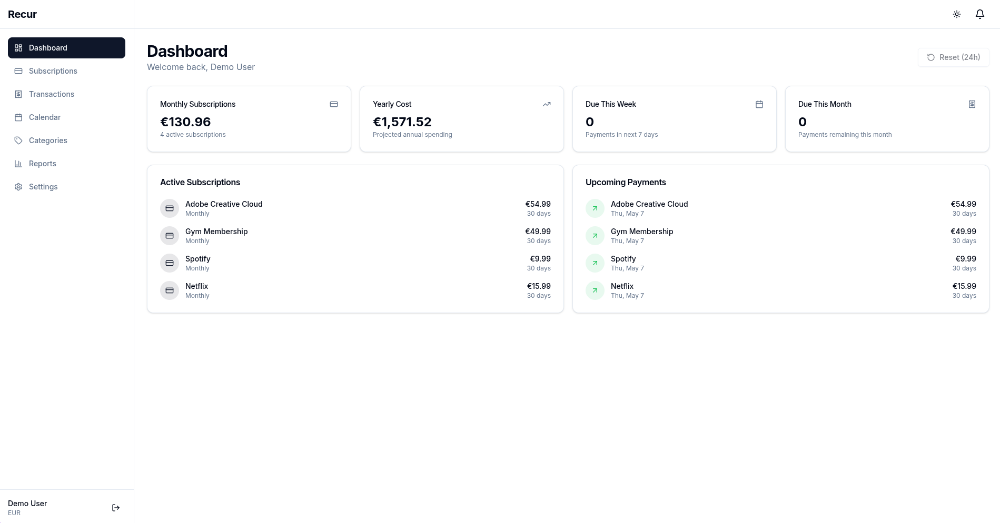

# Recurrency

> Every expense is a subscription.

A self-hosted subscription and expense tracker. Because every purchase is really a question:
*Would I subscribe to this today?*



---

## Quick Start

```bash
git clone https://github.com/alvaro17f/recurrency.git
cd recurrency

# Start all services (frontend, backend, database)
./taskfile up

# Open in browser
open http://localhost:1420
```

**Demo:** Click "Demo account" on the login page.

---

## The `./taskfile` Script

| Command | Description |
|---|---|
| `./taskfile up` | Start all services (DB + backend + frontend) |
| `./taskfile down` | Stop all services |
| `./taskfile test` | Run all tests (backend + frontend) |
| `./taskfile coverage` | Show coverage report |
| `./taskfile reset` | Reset database (⚠️ deletes all data) |
| `./taskfile backend` | Start backend only (port 8080) |
| `./taskfile frontend` | Start frontend only (port 1420) |
| `./taskfile db` | Start PostgreSQL only (port 5432) |
| `./taskfile css` | Build Tailwind CSS once |
| `./taskfile help` | Show help |

**Services:**
- **Frontend:** http://localhost:1420 (Dioxus WASM)
- **Backend:** http://localhost:8080 (Axum)
- **PostgreSQL:** localhost:5432

---

## Production (Docker)

```bash
docker run -d --name recurrency \
  -p 3000:80 \
  -e JWT_SECRET=your-secret-key \
  -e ENABLE_DEMO=true \
  ghcr.io/alvaro17f/recurrency:latest
```

Or with `docker compose`:

```bash
docker compose pull
docker compose up -d
```

---

## Configuration

| Variable | Default | Description |
|---|---|---|
| `DATABASE_URL` | — | PostgreSQL connection |
| `JWT_SECRET` | `change-me-in-production` | Secret for JWT tokens |
| `ENABLE_DEMO` | `true` | Show demo login button |
| `FRONTEND_DIST` | `/frontend/dist` | Path to frontend static files |
| `SMTP_HOST` | — | SMTP server |
| `SMTP_PORT` | `587` | SMTP port |
| `SMTP_USER` | — | SMTP username |
| `SMTP_PASSWORD` | — | SMTP password |
| `SMTP_FROM` | — | Sender email |

---

## Stack

| Layer | Tech |
|---|---|
| **Frontend** | Dioxus (Rust WASM) + Tailwind |
| **Backend** | Rust + Axum + SQLx + JWT + Argon2 |
| **Database** | PostgreSQL |
| **Email** | Resend API |
| **Push** | OneSignal |

---

## Features

| | |
|---|---|
| 💳 **Subscriptions** | CRUD with billing cycles, next-date calc, categories, notes |
| 🧾 **Transactions** | One-time expenses with categories |
| 📅 **Calendar** | Monthly view of upcoming payments |
| 📊 **Reports** | Trend charts, category breakdown, CSV/PDF export |
| 🏷️ **Categories** | Custom icons, colors, inline creation |
| 🔔 **Notifications** | In-app, email, push (OneSignal) |
| 🌙 **Dark Mode** | Light / dark / system |
| 📤 **Grid / List** | Adjustable view |
| 💱 **Currencies** | Multi-currency display |
| 🔄 **Demo Reset** | Restore sample data |
| 📈 **Statistics** | Spending trends, category distribution |
| 🔔 **Reminders** | Configurable notification days |

---

## Test Coverage

| Project | Lines | Functions | Regions | Tests |
|---|---|---|---|---|
| **Backend** | **85.83%** | **85.65%** | **84.55%** | 1123 |
| **Frontend** | **80.04%** | **71.33%** | **79.75%** | 1506 |

Full coverage report (Nix dev shell):

```bash
# Backend tests + coverage
cd backend && nix develop .. -c cargo llvm-cov test --lib

# Frontend tests + coverage
cd frontend && nix develop .. -c cargo llvm-cov test
```

### Coverage Notes

Backend uncovered ~13% = async DB handlers requiring:
- PostgreSQL integration tests (trait injection added for testability)

Frontend uncovered ~20% = RSX macro-generated VDOM requiring:
- Dioxus WASM test runtime

Both projects include comprehensive model/utility tests + mock services.

---

## Architecture

```
backend/src/
├── auth/          # JWT, registration, login
├── subscriptions/ # Subscription CRUD
├── transactions/  # Transaction CRUD
├── categories/     # Category CRUD
├── notifications/  # In-app, email, push
├── reports/       # Statistics, trends
├── preferences/    # User settings
├── demo/          # Demo mode
├── logos/         # Logo search
└── shared/        # DB, auth extractor, utils

frontend/src/
├── pages/          # Route pages
├── components/     # Reusable UI
├── api/            # HTTP client
├── state/          # Signals/state
└── auth/           # Auth pages
```

---

## License

MIT